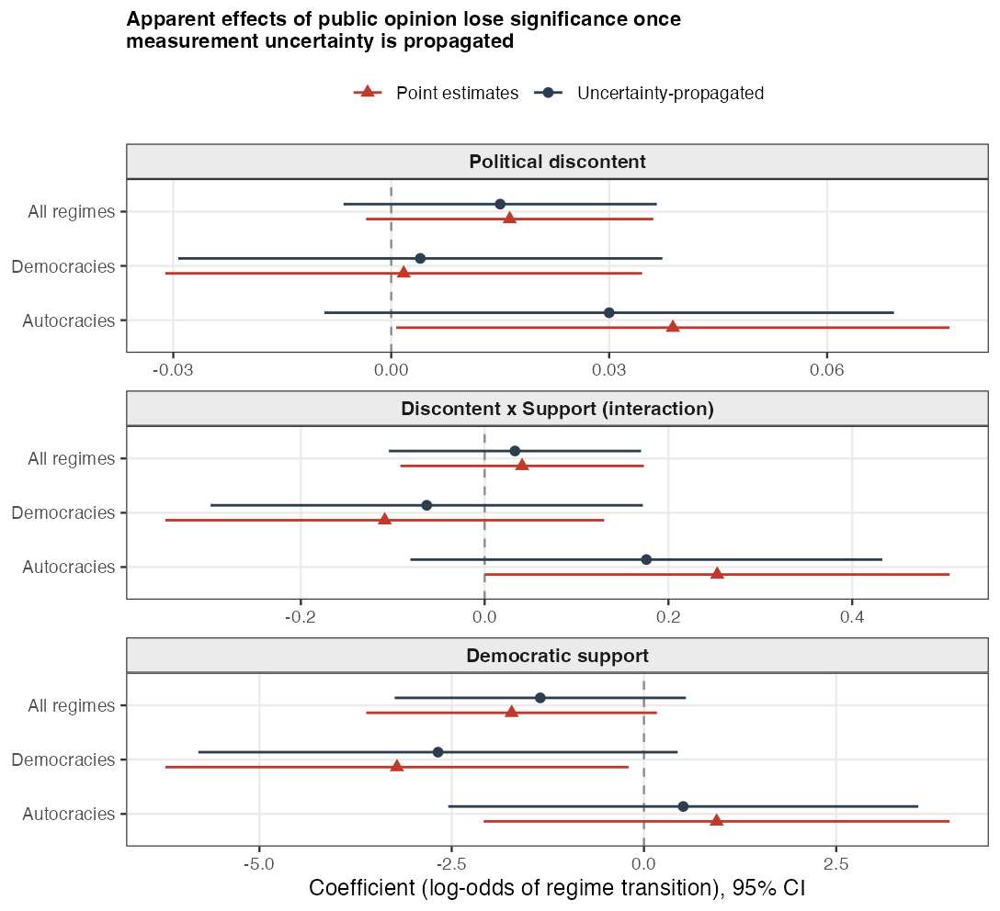

```{r setup}
library(pacman)
p_load(tidyverse, here, kableExtra, rlang)
source(here("data", "customFunctions.R"))
`%||%` <- rlang::`%||%`

star <- function(p) ifelse(p < .01, "***", ifelse(p < .05, "**", ifelse(p < .1, "*", "")))

# generic MOC printer: accepts a draws data.frame OR list(coef=..., n_ev/n_fail, n_obs)
mocTab <- function(x, cap) {
  cap <- gsub("_", "-", cap)   # underscores break LaTeX captions
  meta <- ""
  m <- x
  if (is.list(x) && !is.data.frame(x) && !is.null(x$coef)) {
    m <- x$coef
    ev <- x$n_ev %||% x$n_fail %||% NA
    meta <- sprintf(" (events = %s, obs = %s, draws = %d)",
                    ifelse(is.na(ev), "--", ev), x$n_obs %||% "--", nrow(m))
  } else meta <- sprintf(" (draws = %d)", nrow(m))
  s <- suppressWarnings(MOCsumm(m)) |>
    mutate(estimate = as.numeric(estimate), std.error = as.numeric(std.error),
           z = round(estimate / std.error, 2),
           p = round(2 * (1 - pnorm(abs(z))), 3), sig = star(p),
           OR = round(exp(estimate), 3),
           across(c(estimate, std.error), ~ round(.x, 3)))
  kbl(s |> select(term, estimate, std.error, OR, z, p, sig),
      booktabs = TRUE, longtable = TRUE, linesep = "",
      caption = paste0(cap, meta), escape = TRUE) |>
    kable_styling(font_size = 8, latex_options = c("hold_position", "repeat_header"))
}

# naive printer: tibble with term/est/se(/p)
nvTab <- function(d, cap) {
  cap <- gsub("_", "-", cap)   # underscores break LaTeX captions
  d <- as_tibble(d)
  if (!"p" %in% names(d)) d <- d |> mutate(p = 2 * (1 - pnorm(abs(est / se))))
  meta <- if ("n_ev" %in% names(d)) sprintf(" (events = %d)", d$n_ev[1]) else ""
  s <- d |> mutate(z = round(est / se, 2), sig = star(p), OR = round(exp(est), 3),
                   across(c(est, se, p), ~ round(.x, 3)))
  kbl(s |> select(term, est, se, OR, z, p, sig),
      booktabs = TRUE, longtable = TRUE, linesep = "",
      caption = paste0(cap, " [naive point estimates]", meta), escape = TRUE) |>
    kable_styling(font_size = 8, latex_options = c("hold_position", "repeat_header"))
}
```

# Reading guide

This compendium collects **every model estimated** in the current analysis round, organized from the paper's main specification outward to robustness and superseded models. Throughout: `disc_c` = political discontent (centered, lagged), `supp_c` = democratic support (centered, lagged), `disc_supp` = their interaction; **MOC** = method of composition across 900 paired posterior draws (measurement uncertainty of discontent, support, and V-Dem propagated); **naive** = same model on posterior means. Firth = penalized likelihood for rare events.

**Headline pattern.** Under naive estimation, discontent (autocracies, $p=.046$), its interaction with support (autocracies, $p=.050$), and democratic support (democracies, $p=.037$) appear significant; under MOC all attenuate toward zero and lose significance. Interaction signs are theory-consistent in every specification (democracies $-$, autocracies $+$) but never significant. Controls (regime tenure, GDP, resource dependence) are significant and stable under both estimators.

# Main models: fully specified RoW regime-transition hazard

DV = change in Regimes-of-the-World category (lead-coded); discrete-time hazard; full control set (log GDP, growth, regional democracy, %Muslim, resource dependence, log regime tenure, prior transitions, income inequality, log population).

```{r main}
#| results: asis
hz <- readRDS(here("results_regime_hazard_full.rds"))
pt <- readRDS(here("results_hazard_pointest.rds"))
pairs <- list(
  c("ANY change [all] (glm)", "ANY [all] glm", "Any regime change, all regimes (glm, clustered)"),
  c("DETERIORATION [dem] (Firth)", "DETERIOR [dem] Firth", "Democratic deterioration, democracies (Firth)"),
  c("IMPROVEMENT [aut] (Firth)", "IMPRV [aut] Firth" , "Democratic improvement, autocracies (Firth)"))
pairs[[3]][2] <- "IMPROVE [aut] Firth"
for (pr in pairs) {
  print(nvTab(pt[[pr[2]]], pr[3]))
  print(mocTab(hz[[pr[1]]], paste0(pr[3], " [MOC]")))
}
```

{width=85%}

# Cross-operationalization robustness (5 instability measures)

```{r xop}
#| results: asis
er  <- readRDS(here("results_ert_interaction.rds"))
cx  <- readRDS(here("results_regime_survival.rds"))
rn  <- readRDS(here("results_robust_naive.rds"))
gwf <- readRDS(here("results_gwf_robust.rds"))
cp  <- readRDS(here("results_coup_robust.rds"))

cellf <- function(e, s, p) sprintf("%.3f%s (%.3f)", e, star(p), s)
mg <- function(m, tm) { s <- suppressWarnings(MOCsumm(m)) |>
    mutate(e = as.numeric(estimate), se = as.numeric(std.error), p = 2*(1-pnorm(abs(e/se)))) |>
    filter(term == tm); cellf(s$e, s$se, s$p) }
ng <- function(d, tm) { d <- as_tibble(d)
  s <- mutate(d, p = if ("p" %in% names(d)) p else 2*(1-pnorm(abs(est/se)))) |> filter(term == tm)
  cellf(s$est, s$se, s$p) }
rows <- tribble(~spec, ~regime, ~events, ~naive, ~moc,
 "RoW change (discrete-time)", "Democracies", hz[["DETERIORATION [dem] (Firth)"]]$n_ev, pt[["DETERIOR [dem] Firth"]], hz[["DETERIORATION [dem] (Firth)"]]$coef,
 "RoW change (discrete-time)", "Autocracies", hz[["IMPROVEMENT [aut] (Firth)"]]$n_ev, pt[["IMPROVE [aut] Firth"]], hz[["IMPROVEMENT [aut] (Firth)"]]$coef,
 "ERT reg-trans (discrete-time)", "Democracies", er[["break_dem"]]$n_ev, rn[["regtrans breakdown [dem]"]], er[["break_dem"]]$coef,
 "ERT reg-trans (discrete-time)", "Autocracies", er[["trans_aut"]]$n_ev, rn[["regtrans transition [aut]"]], er[["trans_aut"]]$coef,
 "Cox proportional hazards", "Democracies", cx[["democracies"]]$n_fail, rn[["cox breakdown [dem]"]], cx[["democracies"]]$coef,
 "Cox proportional hazards", "Autocracies", cx[["autocracies"]]$n_fail, rn[["cox democratization [aut]"]], cx[["autocracies"]]$coef,
 "GWF autocratic breakdown", "Autocracies", gwf$n_ev, gwf$naive, gwf$moc,
 "Powell-Thyne coup attempts", "All regimes", cp[["attempt [all] moc"]]$n_ev, cp[["attempt [all] naive"]], cp[["attempt [all] moc"]]$coef,
 "Powell-Thyne coup attempts", "Autocracies", cp[["attempt [aut] moc"]]$n_ev, cp[["attempt [aut] naive"]], cp[["attempt [aut] moc"]]$coef)
out <- rows |> rowwise() |>
  mutate(int_n = ng(naive, "disc_supp"), int_m = mg(moc, "disc_supp"),
         dis_n = ng(naive, "disc_c"),    dis_m = mg(moc, "disc_c")) |> ungroup()
tab <- out |> select(regime, events, int_n, int_m, dis_n, dis_m)
colnames(tab) <- c(" ", "Events", "Point est.", "Uncertainty", "Point est.", "Uncertainty")
kbl(tab, booktabs = TRUE, escape = TRUE, align = c("l","c",rep("c",4)), linesep = "",
    caption = "Focal coefficients across five instability operationalizations") |>
  add_header_above(c(" " = 2, "Discontent x Support" = 2, "Political discontent" = 2)) |>
  pack_rows(index = table(factor(out$spec, levels = unique(out$spec)))) |>
  kable_styling(font_size = 8, latex_options = c("hold_position", "scale_down"))
```

# Specification robustness: period dummies and cubic duration

Period dummies: reference 1988--99, `per2000s`, `per2010s`. Cubic replaces log-tenure with $t, t^2, t^3$.

```{r spec}
#| results: asis
sp <- readRDS(here("results_hazard_spec_robust.rds"))
for (nm in names(sp)) {
  r <- sp[[nm]]
  if (is.data.frame(r)) print(nvTab(r, nm)) else print(mocTab(r, paste0(nm, " [MOC]")))
}
```

# ERT reg-trans models (interaction and main-effect versions)

```{r ert}
#| results: asis
for (nm in names(er)) print(mocTab(er[[nm]], paste0("ERT interaction: ", nm, " [MOC]")))
ed <- readRDS(here("results_ert_discrete.rds"))
for (nm in names(ed)) print(mocTab(ed[[nm]], paste0("ERT main-effect (pre-interaction round): ", nm, " [MOC]")))
```

# Cox regime-survival models

```{r cox}
#| results: asis
for (nm in names(cx)) print(mocTab(cx[[nm]], paste0("Cox survival: ", nm, " [MOC]")))
```

# GWF and Powell-Thyne supplementary models

```{r gwfcp}
#| results: asis
print(nvTab(gwf$naive, sprintf("GWF autocratic breakdown (Firth; events=%d, obs=%d)", gwf$n_ev, gwf$n_obs)))
print(mocTab(list(coef = gwf$moc, n_ev = gwf$n_ev, n_obs = gwf$n_obs), "GWF autocratic breakdown [MOC]"))
for (nm in names(cp)) {
  r <- cp[[nm]]
  if (is.data.frame(r)) print(nvTab(r, paste0("Coups: ", nm))) else print(mocTab(r, paste0("Coups: ", nm, " [MOC]")))
}
```

# Mobilization channel (auxiliary DV: V-Dem mass mobilization)

Dynamic panel (two lags of DV), pooled OLS and system GMM; DV-side uncertainty also drawn.

```{r mob}
#| results: asis
mb <- readRDS(here("results_mobilization.rds"))
for (nm in names(mb)) print(mocTab(mb[[nm]], paste0("Mobilization: ", nm, " [MOC]")))
```

# Superseded: V-Dem democracy-level DV (retained for the record)

The liberal-democracy *level* DV measures democratic quality/erosion, not regime stability, and was replaced (JC decision) by the transition/survival DVs above. Reported for completeness.

```{r libdem}
#| results: asis
r2 <- readRDS(here("results2.rds"))
for (nm in names(r2)) print(mocTab(r2[[nm]], paste0("Libdem level (Claassen design): ", nm, " [MOC]")))
si <- readRDS(here("results_support_interaction.rds"))
for (nm in names(si)) print(mocTab(si[[nm]], paste0("Libdem level, disc x supp: ", nm, " [MOC]")))
sb <- readRDS(here("results_support_interaction_byregime.rds"))
for (nm in names(sb)) print(mocTab(sb[[nm]], paste0("Libdem level, disc x supp by regime: ", nm, " [MOC]")))
```
